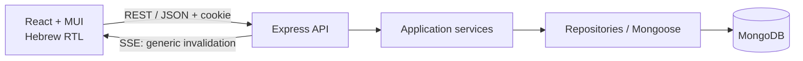
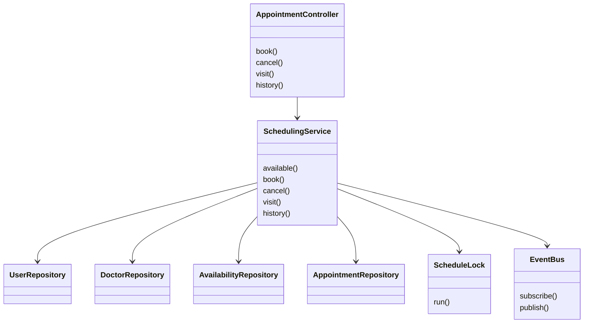
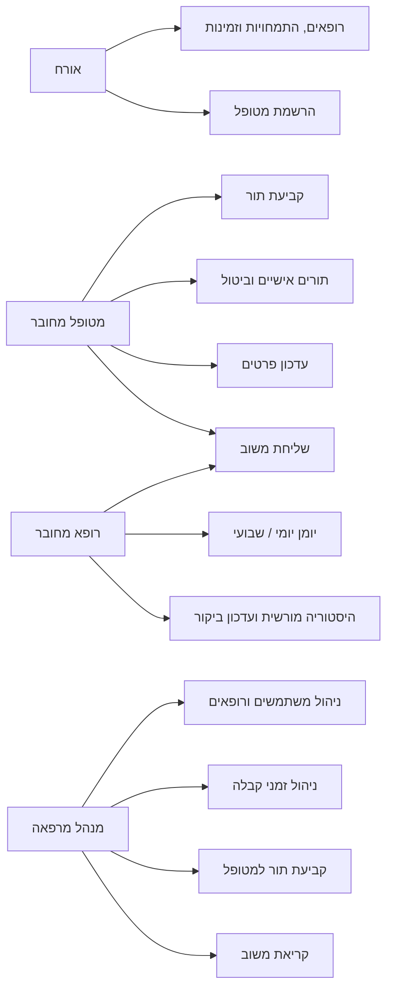
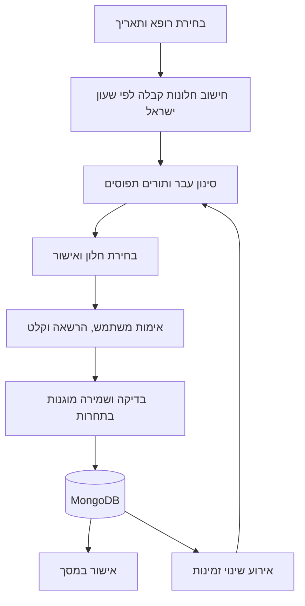
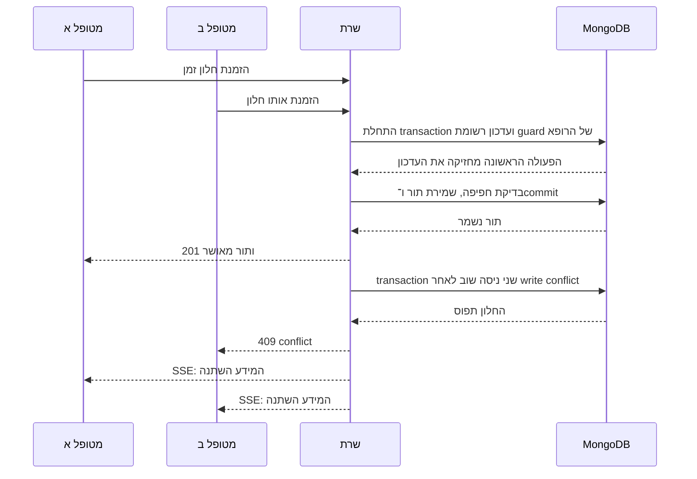

# ארכיטקטורת MedTime

## גבולות המערכת

MedTime היא מערכת Client–Server. הלקוח מציג מידע ומנהל אינטראקציות; כל החלטת הרשאה, זמינות ועדכון נתונים מתבצעת בשרת. MongoDB הוא מקור האמת. הטיפוסים בחבילה `@medtime/shared` מצמצמים אי־התאמות בין שני הצדדים, ואימות קלט בזמן ריצה מגן על גבול ה־API.



## חלוקה לשכבות ודפוסי תכנון

| רכיב                 | אחריות                                  | הסיבה להפרדה                                  |
| -------------------- | --------------------------------------- | --------------------------------------------- |
| Routes / Controllers | התאמת בקשות HTTP לפעולות והחזרת DTO     | שמירת לוגיקה עסקית מחוץ לפרוטוקול HTTP        |
| Services             | כללי זמינות, הרשאות עסקיות ומעברי סטטוס | מקור אחד לכללים, גם כאשר נוספות כניסות למערכת |
| Repositories         | קריאה וכתיבה מול MongoDB                | ריכוז שאילתות והפרדה מתצוגה ומכללים עסקיים    |
| Models               | סכמות, אינדקסים ואילוצי שמירה           | אכיפת מבנה נתונים והגנות מסד                  |
| Middleware           | אימות זהות, בדיקת תפקידים ושגיאות       | טיפול עקבי בדרישות רוחב                       |
| Shared DTOs          | חוזי נתונים בין לקוח לשרת               | חשיפת מידע שנדרש למסך בלבד                    |

**Repository:** השירות מבקש פעולות בעלות משמעות עסקית במקום לפזר שאילתות Mongoose במסכי HTTP.

**Dependency Injection:** תלויות השירותים מועברות בעת הרכבת המערכת. ניתן להבין מה כל שירות צריך ולהחליף תלות בבדיקות בלי תלות גלובלית במודול.

**Observer / Publish–Subscribe:** עדכון תור מפרסם אירוע כללי. חיבורי SSE מודיעים ללקוח שהמידע השתנה, והלקוח קורא מחדש את הנתונים המותרים עבור המשתמש. האירוע עצמו אינו כולל שמות מטופלים, פרטים רפואיים או פרטי תור.

דפוסים אלה פותרים צרכים קיימים; אין צורך במחלקה או Factory לכל פונקציה. קומפוננטות משותפות בלקוח מרכזות טפסים, הודעות, מודלים ותצוגת תורים.

## מפת המחלקות במימוש

כל controller וכל repository נמצאים בקובץ משלהם. הפיצול נעשה לפי תחום אחריות, והמחלקות אינן מאוגדות בבקר מרפאה יחיד או במאגר נתונים יחיד.

| תחום                     | Controller              | Service                                        | Repository                                                                              |
| ------------------------ | ----------------------- | ---------------------------------------------- | --------------------------------------------------------------------------------------- |
| זהות ופרופיל             | `AuthController`        | `AuthService`                                  | `UserRepository`                                                                        |
| מידע על רופאים           | `DoctorController`      | `DoctorService`                                | `DoctorRepository`, `UserRepository`, `AvailabilityRepository`                          |
| תורים והיסטוריית ביקורים | `AppointmentController` | `SchedulingService`                            | `AppointmentRepository`, `DoctorRepository`, `UserRepository`, `AvailabilityRepository` |
| ניהול המרפאה             | `AdminController`       | `AdminService`, `AuthService`, `DoctorService` | מאגרי המשתמשים, הרופאים, הזמינות והתורים                                                |
| הצעות ומשוב              | `FeedbackController`    | `FeedbackService`                              | `FeedbackRepository`                                                                    |

`ScheduleLock` מרכז את הגנת ה־transaction ליומן רופא; `EventBus` מרכז את מנויי SSE ואת פרסום האירועים. שניהם מוזרקים לשירותים הזקוקים להם. המרות ממסמכי Mongoose ל־DTO מרוכזות ב־`server/src/mappers/dto.ts`, כך שהצגת מידע אינה אחריות של repository כללי.

`server/src/routes/index.ts` משמש כ־**Composition Root**: הוא יוצר את המאגרים, מעביר אותם לבנאי השירותים ומעביר את השירותים לבנאי הבקרים. הנתיבים מפנים למתודות הבקרים. התלויות מפורשות, ללא Service Locator או רישום תלות נסתר בזמן בקשה.

```text
server/src/
  controllers/   auth, doctor, appointment, admin, feedback
  services/      auth, doctor, scheduling, admin, feedback, lock, events
  repositories/ user, doctor, availability, appointment, feedback
  mappers/       המרות DTO
  models/        סכמות Mongoose ואינדקסים
  middleware/    אימות, הרשאות, אימות קלט ושגיאות
  routes/        חיבור המחלקות ונתיבי HTTP
  config/        תצורה וחיבור MongoDB
```

הקשרים המרכזיים בהזמנת תור:



הלקוח נשאר במודל קומפוננטות ו־hooks של React: מסכים לפי תפקיד, טפסים ומודלים נפרדים, מתאם HTTP ומצב אימות משותף. אין צורך להמיר קומפוננטות React למחלקות כדי לשמור על הפרדת אחריות.

## מודל נתונים

```mermaid
erDiagram
    USER ||--o| PATIENT : "patient profile"
    USER ||--o| DOCTOR : "doctor profile"
    USER ||--o{ APPOINTMENT : "patient"
    DOCTOR ||--o{ APPOINTMENT : "assigned doctor"
    USER ||--o{ FEEDBACK : "submitted by"
    DOCTOR ||--|| AVAILABILITY : "schedule"
    AVAILABILITY ||--o{ WORKING_HOURS : "embedded rules"
    USER {
        string id
        string role
        string email
        string passwordHash
        boolean active
    }
    DOCTOR {
        string id
        string userId
        string specialty
    }
    PATIENT {
        string id
        string userId
    }
    AVAILABILITY {
        string id
        string doctorId
        number slotMinutes
    }
    APPOINTMENT {
        string id
        string doctorId
        string patientId
        datetime startAt
        datetime endAt
        string status
    }
    WORKING_HOURS {
        number dayOfWeek
        string start
        string end
    }
    FEEDBACK {
        string id
        string category
        string message
        datetime createdAt
    }
```



`User` מרכז זהות ופרטי קשר. `Patient` ו־`Doctor` מקשרים לפרופיל המשתמש, ו־`Availability` שומר את אורך התור ואת כללי הקבלה המשובצים של הרופא. אין שכפול של סיסמאות או כתובות דוא״ל בין ישויות. תור מקשר בין הרופא למשתמש המטופל ושומר זמני התחלה וסיום ב־UTC. שמות המטופל והרופא וההתמחות נשמרים גם בתור כצילום מצב היסטורי.

## Use cases



בחירת תפקיד במסך התחברות אינה מעניקה תפקיד. השרת משווה את הבחירה לתפקיד ששמור בחשבון. הרשמה ציבורית יוצרת מטופל בלבד; יצירת רופא דורשת מנהל מרפאה.

## Data flow



רופא מקבל יומן המסונן לרופא המחובר. כאשר הוא פותח היסטוריה, השרת בודק קשר טיפולי מתאים. לאחר עדכון ביקור נשמרים סטטוס וסיכום בשרת. מנהל שמזמין בשם מטופל משתמש באותו מנגנון זמינות המשמש מטופלים.

## Sequence: שתי הזמנות מתחרות



בדיקת `find` ולאחריה `insert` ללא הגנה במסד אינה מספיקה למניעת תחרות. פעולת יומן רצה ב־MongoDB transaction ומעדכנת רשומת guard משותפת לכל רופא; פעולות מתחרות על אותו רופא גורמות ל־write conflict וניסיון חוזר. בדיקת הזמינות והשמירה מתבצעות באותה transaction. אינדקס ייחודי על חלון פעיל הוא הגנה נוספת להזמנת אותה שעת התחלה. עריכת שעות, ביטול ועדכון ביקור משתמשים באותו מנגנון. אין הסתמכות על נעילה בזיכרון של תהליך יחיד או על נעילה שפג תוקפה בזמן שפעולה עדיין רצה.

מנגנון זה מחייב MongoDB replica set או cluster שתומך ב־transactions. לפיתוח די ב־replica set בעל node יחיד; הוא מספק transactions אך אינו מספק יתירות. ביטול שומר את רשומת התור להיסטוריה ומשחרר את החלון להזמנה בהתאם לכללים.

## זמן, הרשאות ואבטחה

- התצוגה וכללי שעות הקבלה משתמשים ב־`Asia/Jerusalem`; ה־API ומסד הנתונים שומרים UTC.
- אימות קלט קפדני חוסם שדות לא מוכרים וערכי שאילתה שאינם מהטיפוס הצפוי. אין העברת אובייקט בקשה ישירות למסנן MongoDB.
- סיסמאות נשמרות באמצעות bcrypt; ה־API אינו מחזיר hash.
- האימות מבוסס cookie עם `HttpOnly` ו־`SameSite`. הפעלת HTTPS והגדרת cookie מאובטח נדרשות בסביבת ייצור.
- ההרשאה נבדקת בשרת גם אם כפתור הוסתר בלקוח. השבתת חשבון מונעת המשך שימוש בבקשות הבאות.
- SSE הוא אות לרענון מידע, ואינו מחליף אימות זמינות בשרת.

מנגנון SSE הנוכחי מפרסם אירועים בחיבורים של תהליך ה־API שמטפל בעדכון. לפני פריסה עם כמה תהליכי API יש לחבר מתווך אירועים משותף או MongoDB change streams, כדי שכל תהליך יקבל גם אירועים שנוצרו באחרים. הגנות השמירה ב־MongoDB אינן תלויות במנגנון ההתראות.

הרשומות הקליניות הן נתונים רגישים. פריסה עם נתוני אמת דורשת תשתית והרשאות תפעוליות מתאימות, TLS, גיבויים וניהול סודות. רישום טקסט פנימי אינו מרשם רפואי חתום או שירות חתימה דיגיטלית.
